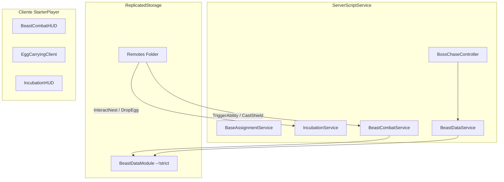

# VAULT POP! — Especificación Técnica del Sistema de Huevos, Criaturas y Batallas
**Documento de Especificación de Diseño y Arquitectura (Pre-Implementación)**

- **Archivo:** `CREATURE_SYSTEM_SPEC.md`
- **Versión:** 1.0.0
- **Fecha:** Octubre 2026
- **Estado:** Especificación Aprobada para Revisión (Sin código ni modelos creados todavía)
- **Ámbito:** Workspace `primer juego` / Roblox Studio (`PlaceId: 87965587462014`)

---

## 1. Estado Actual vs. Propuesta Futura

Para asegurar la integridad del proyecto y no romper ningún sistema preexistente, delimitamos con precisión las fronteras del DataModel:

| Sistema / Componente | Estado Real en Studio | Función en la Nueva Fase |
| :--- | :---: | :--- |
| **5 Parcelas de Base (`BasePlots.Base_1..5`)** | **100% Implementado** | Se conserva la asignación autoritativa (`BaseAssignmentService`), los letreros y las zonas centrales. Se añadirán en sus patios las ranuras físicas de incubadoras. |
| **10 Estaciones (`Treadmill` / `Strength`)** | **100% Implementado** | Se mantienen fuera de las cercas con su economía de niveles. `Treadmill` aumentará la velocidad de escape del jefe; `Strength` mitigará la lentitud al cargar huevos pesados. |
| **20 Biomas y Jefes (`BossArena.Zones`)** | **100% Implementado** | Se mantienen los 20 modelos, cotas $Y$, barras de vida y daño por contacto (`BossArenaSystem`). Se incorporará en cada bioma un **Nido Elemental** interactivo. |
| **Arena Beast Battles (`UnifiedCombatArena`)** | **100% Implementado** | Plataforma continua unificada ($100 \times 80\text{ studs}$), cuerdas, braseros y gradas listas. Se convertirá en el escenario de los duelos de criaturas. |
| **Tiendas (`UpgradesShop` / `PremiumShop`)** | **100% Implementado** | `UpgradesShop` seguirá vendiendo mejoras con monedas del juego. `PremiumShop` queda reservada para futuros cosméticos (sin compras simuladas). |
| **Nidos de Huevos en Biomas** | **100% Implementado** | 20 nidos en $X=75$ cada 500 studs en $Z$, generación de 35 huevos silvestres con escala real. |
| **Incubadoras y Eclosión POP en Base** | **100% Implementado** | 10 incubadoras físicas (2 por base en Base_1 a 5) con temporizadores de servidor y eclosión POP! |
| **Inventario y Datos de Criaturas (`BeastData`)** | **100% Implementado** | `BeastDataModule` con 20 biomas y probabilidades exactas; `CreatureInventoryManager` con persistencia. |
| **IA de Persecución del Jefe (`BossChase`)** | **Propuesta Futura** | A diseñar en Sprint 3. |
| **Combate Automático en Beast Battles** | **Propuesta Futura** | A diseñar en Sprint 4. |

---

## 2. Los 20 Biomas, Huevos y Especies de Criaturas

Cada uno de los 20 biomas contiene un **Nido Físico** con su correspondiente Huevo Temático. Cada huevo puede eclosionar en una de las especies autóctonas del bioma según su tabla de probabilidades:

| # | Bioma | Jefe Guardián | Huevo Elemental | Criatura Común (58%) | Criatura Rara / Épica (15%) | Criatura Mítica / Legendaria (1%) |
| :---: | :--- | :--- | :--- | :--- | :--- | :--- |
| **01** | Bosque Encantado | Guardián del Bosque | Huevo Silvestre | **Pardillo Musgoso** | **Zorro Floral** | **Ciervo Ancestral** |
| **02** | Cueva de Piedra | Golem de Roca | Huevo Geoda | **Topillo de Pizarra** | **Geoda Viviente** | **Gárgola de Obsidiana** |
| **03** | Tundra Helada | Bruja de Hielo | Huevo de Escarcha | **Pingüino Nevado** | **Lobo Ártico** | **Búho Criomántico** |
| **04** | Volcán Ardiente | Dragón de Fuego | Huevo Ígneo | **Salamandra de Ceniza** | **Basilisco de Fuego** | **Draco Ignis** |
| **05** | Desierto Infinito | Escorpión de Arena | Huevo de Arenisca | **Escarabajo Solar** | **Víbora de las Dunas** | **Fénix del Desierto** |
| **06** | Meseta Tormentas | Titán del Trueno | Huevo Voltaico | **Chispa Plumada** | **Gato del Trueno** | **Grifo Relampagueante** |
| **07** | Mazmorra Oscura | Asesino Sombras | Huevo Umbrío | **Murciélago Espectral** | **Gárgola Nocturna** | **Segador de Pesadillas** |
| **08** | Pantano Venenoso | Serpiente Tóxica | Huevo Tóxico | **Rana de Fango** | **Cobra de Ácido** | **Hidra del Lodazal** |
| **09** | Caverna de Cristal | Espectro Cristal | Huevo Prismático | **Caracol de Amatista** | **Escarabajo Diamante** | **Gólem Prismático** |
| **10** | Cementerio Antiguo | Rey No-Muerto | Huevo Sepulcral | **Can Huesudo** | **Cuervo de Cripta** | **Pesadilla Esquelética** |
| **11** | Abismo Acuático | Leviatán Marino | Huevo Oceánico | **Cangrejo Coralino** | **Tiburón Abisal** | **Krakencito Místico** |
| **12** | Templo Celestial | Sílfide del Viento | Huevo Etéreo | **Gorrión del Viento** | **Pegaso Nuboso** | **Sílfide Iluminada** |
| **13** | Cámara de Lava | Behemoth Lava | Huevo de Magma | **Lagarto de Lava** | **Tortuga Ígnea** | **Quimera de Fuego** |
| **14** | Arboleda Sagrada | Druida Naturaleza | Huevo Druídico | **Conejo Espinado** | **Búho Sabio** | **Treant Titánico** |
| **15** | Forja Infernal | Coloso de Metal | Huevo Mecánico | **Enchufe Robot** | **Automaton Engranado** | **Coloso de Vapor** |
| **16** | Ruptura del Vacío | Caminante Vacío | Huevo del Vacío | **Sombra Rastreadora** | **Ojo Abisal** | **Devorador Cósmico** |
| **17** | Arena Celestial | Paladín de Luz | Huevo Radiante | **Polilla de Luz** | **León Querubín** | **Serafín Resplandeciente** |
| **18** | Ciudadela Hueso | Nigromante Oscuro | Huevo de Ceniza | **Espectro Errante** | **Banshee Lamentadora** | **Dragón Funerario** |
| **19** | Grieta Infernal | Demonio del Caos | Huevo del Caos | **Diablillo Carmesí** | **Gargantúa Infernal** | **Señor de la Grieta** |
| **20** | Trono Final | Dios Antiguo | Huevo Primordial | **Orbe Cósmico Menor** | **Vanguardia Temporal** | **Avatar del Infinito** |

---

## 3. Mecánica de Extracción de Huevos y Modo Persecución (Boss Chase)

### 3.1 Interacción con el Nido
- En el extremo posterior de cada bioma se ubica un **Pedestal/Nido Rúnico**.
- Acercarse muestra un `ProximityPrompt`: `[E] Recoger Huevo Elemental`.
- Al tomarlo:
  1. El huevo se ancla visualmente a los brazos del jugador (`CarryingEgg`).
  2. El modelo emite un destello visual acorde a su categoría de rareza aproximada (Luz blanca para comunes, azul para raros, destellos dorados para legendarios).
  3. **No es obligatorio derrotar al jefe**, pero tomar el huevo **activa inmediatamente el estado de alerta del jefe de la zona**.

### 3.2 La Persecución del Jefe
- El jefe de la zona abandona su pedestal central y comienza una persecución activa hacia el jugador con una velocidad calibrada:
  - Velocidad del jefe base: $18\text{ studs/s}$ (ligeramente superior a los $16\text{ studs/s}$ del jugador por defecto).
- **Rol de la Cinta (`🏃 TREADMILL`):**
  - Cada nivel de velocidad del jugador aumenta su `WalkSpeed` de forma persistente.
  - Con entrenamiento en cinta, el jugador puede alcanzar entre $20$ y $28\text{ studs/s}$, permitiéndole tomar ventaja sobre el jefe y sortear las curvas del camino.
- **Rol de las Pesas (`💪 STRENGTH`):**
  - Los huevos poseen un valor físico de peso ($10\text{ kg}$ en biomas iniciales hasta $60\text{ kg}$ en biomas avanzados).
  - Un jugador con fuerza baja sufre un debuff de lentitud: $\text{Penalización} = \text{Peso} \times 0.5\%$.
  - Entrenar fuerza en las pesas aumenta la capacidad de carga del personaje (`MaxCarryWeight`), anulando la penalización de lentitud para que el jugador corra a máxima velocidad incluso con huevos legendarios de biomas finales.

### 3.3 Protección contra Pérdidas Injustas (Fair Play & Escape)
Para evitar la frustración de perder tiempo o ser acampado por el jefe:
1. **Barrera de Escape Seguro:** Una vez que el jugador cruza el portal de salida del bioma hacia el camino de adoquines, el jefe detiene la persecución inmediatamente, emite un rugido y regresa a su puesto en el bioma.
2. **Ventana de Gracia tras Impacto:** Si el jefe alcanza al jugador, no lo elimina de un solo golpe:
   - El primer impacto causa un tropiezo (`Stumble`) y restaura un escudo de invulnerabilidad de $2.5\text{ segundos}$ para permitir una última oportunidad de reacción y esquive.
3. **Pérdida Amortiguada:** Si la salud del jugador llega a cero antes de escapar:
   - El huevo cae al suelo protegido por un escudo rúnico durante $30\text{ segundos}$. El jugador reaparece en la entrada de ese mismo bioma (no en el spawn lejano del lobby) con la oportunidad de recogerlo rápidamente y continuar su huida.

---

## 4. Sistema de Incubación en la Base

Cada jugador administra sus incubadoras dentro de su parcela privada (`Base_1` a `Base_5`):

### 4.1 Ranuras y Desbloqueo Progresivo
- **2 Ranuras Gratuitas:** Disponibles desde el primer segundo de juego.
- **Hasta 4 Ranuras Adicionales:** Desbloqueables en el patio de la base mediante monedas normales obtenidas jugando:
  - **Incubadora 3:** $500\text{ Monedas}$
  - **Incubadora 4:** $2\,000\text{ Monedas}$
  - **Incubadora 5:** $8\,000\text{ Monedas}$
  - **Incubadora 6 (Máximo):** $25\,000\text{ Monedas}$

### 4.2 Tiempos de Incubación y Señales Visuales
Los tiempos están balanceados para mantener un ritmo dinámico de juego:

| Rareza Revelada | Tiempo de Incubación | Señal Visual en el Huevo | Probabilidad Base |
| :--- | :---: | :--- | :---: |
| **Común** | $45\text{ segundos}$ | Cascarón liso, pulso suave blanco | $58.0\%$ |
| **Poco Común** | $2\text{ minutos}$ | Grietas con ligero resplandor verde | $26.0\%$ |
| **Rara** | $5\text{ minutos}$ | Resplandor azul zafiro, vapor frío | $11.0\%$ |
| **Épica** | $12\text{ minutos}$ | Relámpagos púrpuras sutiles alrededor | $4.0\%$ |
| **Legendaria** | $25\text{ minutos}$ | Corona de ascuas doradas, latido rítmico | $0.9\%$ |
| **Mítica / Secreta** | $50\text{ minutos}$ | Aura cósmica prismática y música ambiental tenue | $0.1\%$ |

- **Información Visible:** Cada incubadora muestra un `BillboardGui` 3D sobre el cascarón con la barra de tiempo restante y el mensaje: `🥚 INCUBANDO... [03:42]`.
- **Eclosión POP!:** Al concluir el tiempo, el botón cambia a `💥 ¡ABRIR HUEVO!`. Al presionarlo, el huevo tiembla elásticamente mediante `TweenService`, explota en confeti temático y revela en pantalla completa la tarjeta de la criatura obtenida con sus estadísticas generadas.

---

## 5. Economía Pasiva: Colección en la Base

### 5.1 Pedestales de Hábitat
- La zona central de la base (`CollectionZone`) se equipa con **8 pedestales de exhibición**.
- El jugador puede asignar libremente hasta 8 de sus criaturas obtenidas para que habiten en su base.
- Cada criatura genera **Monedas por Segundo** de acuerdo con su fórmula de poder:

$$\text{Monedas/seg} = \text{BaseRareza} \times (1 + (\text{Nivel} - 1) \times 0.15) \times \text{MultiplicadorBioma}$$

- **Valores Base por Rareza:**
  - Común: $1\text{ moneda/s}$
  - Poco Común: $3\text{ monedas/s}$
  - Rara: $8\text{ monedas/s}$
  - Épica: $22\text{ monedas/s}$
  - Legendaria: $65\text{ monedas/s}$
  - Mítica: $200\text{ monedas/s}$

### 5.2 Banco de Monedas y Límite de Almacenamiento (Anti-Inflación)
- El cofre central de la base acumula las monedas pasivas generadas mientras el jugador entrena o explora.
- **Límite de Almacenamiento Inicial:** $5\,000\text{ Monedas}$ (aumentable en la `UPGRADES SHOP` con monedas del juego hasta $250\,000$).
- Esto exige al jugador regresar periódicamente a su base a recoger su tesoro, manteniendo la rotación activa del loop sin permitir que cuentas desatendidas revienten la economía.

---

## 6. Sistema de Combate: BEAST BATTLES

Ubicado en el cuadrilátero monumental unificado (`UnifiedCombatArena`):

### 6.1 Modalidad: Combate Automático en Tiempo Real con Intervención Táctica
- **Preparación:** Los dos jugadores suben a las esquinas opuestas de la plataforma (Esquina Roja vs Esquina Azul) y confirman su criatura campeona.
- **Flujo de Batalla:**
  1. Las criaturas se desplazan automáticamente hacia el centro y ejecutan ataques básicos continuos cada $1.2\text{ segundos}$ basados en sus estadísticas físicas (Daño, Velocidad de ataque, Precisión).
  2. **Intervención Activa del Jugador (Entrenador):** En la pantalla del jugador se despliegan **3 botones de comando táctico** con barras de enfriamiento (Cooldowns):
     - **⚡ Habilidad Elemental (Cooldown 8s):** Desata el ataque especial del bioma de la criatura (ej. *Aliento Ígneo*, *Golpe Sísmico*, *Ráfaga de Hielo* con daño aumentado y debuffs de estado).
     - **🛡️ Bloqueo Rúnico / Escudo (Cooldown 12s):** Levanta una barrera que absorbe el $70\%$ del daño durante los siguientes $2.5\text{ segundos}$. Requiere anticipar el ataque fuerte del rival.
     - **🔥 Grito de Entrenador / Furia (Cooldown 20s):** Potencia la velocidad y el daño crítico de la criatura durante $5\text{ segundos}$.

### 6.2 Jerarquía de Fuerza (100% Criatura)
> [!IMPORTANT]
> El nivel físico del jugador (su velocidad de cinta o fuerza de pesas) **NO añade daño ni vida a las criaturas**.
> La victoria depende enteramente de:
> 1. La especie, rareza y nivel de la criatura ($1$ al $50$).
> 2. La ventaja elemental del bioma (Fuego vence a Hielo, Hielo vence a Viento, Viento vence a Tierra, etc.).
> 3. El timing del jugador al activar el escudo y las habilidades especiales.

### 6.3 Protección para Principiantes y Matchmaking
- **División de Ligas por Rango de Criatura:**
  - **Liga Cobre (Tier 1):** Solo criaturas Nivel 1 a 10 (Criaturas Comunes / Poco Comunes). Un jugador novato jamás será emparejado contra un jugador con criaturas míticas o de nivel 40+.
  - **Liga Plata (Tier 2):** Criaturas Nivel 11 a 25.
  - **Liga Oro (Tier 3):** Criaturas Nivel 26 a 40.
  - **Liga Campeones (Tier 4):** Sin límite de nivel.
- **Modo Duelo Amistoso:** Si dos amigos de niveles disparejos desean combatir en el cuadrilátero, las estadísticas de ambas criaturas se normalizan temporalmente al mismo nivel para garantizar un enfrentamiento justo y divertido.

---

## 7. Arquitectura Técnica y Módulos de Código Luau

Siguiendo las Directivas del Proyecto (`--!strict`, modularidad desacoplada, menos de 250 líneas por script y seguridad Server-Authoritative):

### 7.1 Módulos a Crear
1. **`ReplicatedStorage.Modules.BeastDataModule` (`--!strict`):**
   - Catálogo estático inmutable con los datos de las 60 criaturas (nombres, biomas, rarezas, multiplicadores de monedas, ataques base y modelos).
2. **`ServerScriptService.IncubationService` (`--!strict`):**
   - Gestión de nidos en biomas, cálculo autoritativo de temporizadores de huevos en parcelas de base y validación de desbloqueo de incubadoras con monedas mediante `PlayerStateManager`.
3. **`ServerScriptService.BossChaseController` (`--!strict`):**
   - Gestión de IA y `PathfindingService` temporal para que los jefes persigan al jugador portador del huevo hasta el límite del bioma.
4. **`ServerScriptService.BeastCombatService` (`--!strict`):**
   - Lógica autoritativa del combate en el cuadrilátero Beast Battles, validación de cooldowns de habilidades de entrenador y entrega de premios.

---

## 8. Hoja de Ruta de Implementación por Sprints

Para garantizar estabilidad total, pruebas continuas y cero regresiones en lo ya construido:

- **Sprint 1 — Núcleo de Datos y Nidos de Biomas:**
  - Crear `BeastDataModule` con tipado estricto Luau.
  - Diseñar e instalar los 20 pedestales/nidos rúnicos en los 20 biomas existentes sin alterar a los jefes.
  - Implementar la recolección física del huevo (`EggCarrying`) con afectación de peso vs fuerza del jugador.
- **Sprint 2 — Incubadoras y Sistema de Eclosión en Base:**
  - Instalar los modelos de incubadoras en los patios de las 5 bases (2 libres + 4 bloqueadas con carteles de costo en monedas).
  - Programar la cuenta regresiva autoritativa en el servidor y la animación de apertura "POP!" con revelación de criatura.
  - Conectar los pedestales de la `CollectionZone` central para la generación pasiva de monedas con cofre acumulador.
- **Sprint 3 — IA de Persecución y Evasión de Jefes:**
  - Programar el controlador `BossChaseController` para que el jefe persiga activamente al ladrón del huevo.
  - Conectar la velocidad del jugador desde la cinta de correr (`Treadmill`) para permitir la evasión ágil.
  - Integrar la zona segura en la salida del bioma y el sistema de reintento justo.
- **Sprint 4 — Sistema de Batallas Beast Battles:**
  - Instalar los spawners en las esquinas del ring unificado `UnifiedCombatArena`.
  - Crear la interfaz de combate con barras de vida duales y los 3 botones de habilidad de entrenador con cooldown.
  - Configurar las ligas de emparejamiento equilibrado y recompensas de victoria.
